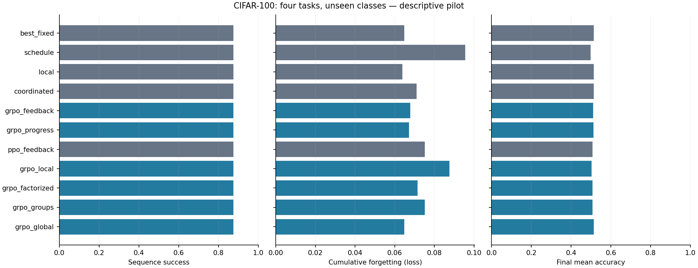
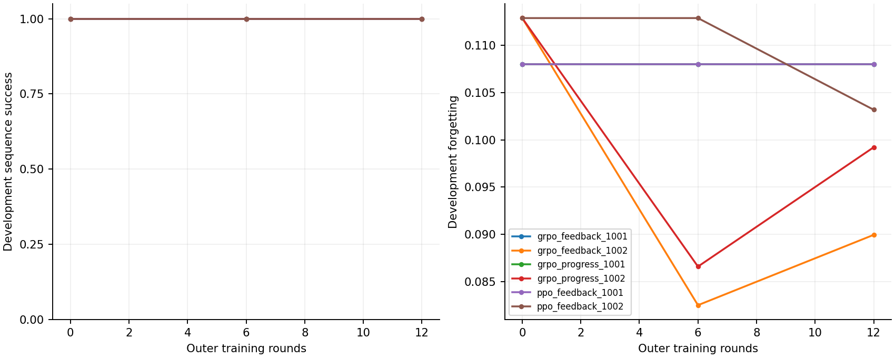

# v10 视觉闭环实验：结果解读

2026-09-18。已完成真实CIFAR-100环境、逐expert实际AdamW位移控制、GRPO/PPO训练、开发闭环选模与独立评价。当前结果没有验证旧知识反馈增益，也没有验证逐expert学习控制超过最佳固定/全局倍率；GRPO相对本轮PPO有探索性正信号。它们都是小样本pilot结论，不是对研究方向的普遍否定或确认。

## 已完成的实验

2层×4 experts、top-2、宽48，共84,044参数；冻结router参数但允许表示驱动的动态路由。固定容量、四个五类任务、目标monitor交叉熵1.25、每任务最多200次更新、每10步检查。首任务统一训练，之后控制。训练/开发/测试类别0–59/60–79/80–99，最终八个根历史、两个控制器初始化。

主比较为7类学习策略×2初始化，每个12轮、B=1/G=4，8条训练根历史；另有2根相同训练量及8根36轮对照。全部从真实当前行为策略闭环采样，累计1,056分支，230,920次分支内learner更新。不是只搭框架或只测随机张量。

## 独立评价

| 方法 | 全序列达标 | 累计遗忘 | 最终平均loss | 最终accuracy |
|---|---:|---:|---:|---:|
| best_fixed | 87.5% | 0.06490 | 1.2110 | 51.5% |
| schedule | 87.5% | 0.09555 | 1.2499 | 49.8% |
| local | 87.5% | 0.06382 | 1.2177 | 51.4% |
| coordinated | 87.5% | 0.07099 | 1.2246 | 51.5% |
| grpo_feedback | 87.5% | 0.06778 | 1.2187 | 51.1% |
| grpo_progress | 87.5% | 0.06723 | 1.2197 | 51.2% |
| ppo_feedback | 87.5% | 0.07517 | 1.2309 | 50.7% |
| grpo_local | 87.5% | 0.08764 | 1.2378 | 50.3% |
| grpo_factorized | 87.5% | 0.07158 | 1.2294 | 50.8% |
| grpo_groups | 87.5% | 0.07517 | 1.2309 | 50.7% |
| grpo_global | 87.5% | 0.06490 | 1.2110 | 51.5% |

所有方法的序列达标率均为87.5%（7/8）；共同失败发生在root1030000的第二任务。保留失败、终点loss和失败后表现，不改阈值，也不只展示成功子集。观察值未达到预定90%可行性目标；两初始化与八根历史不足以确认总体达标率、5pp非劣效或稳定优越性。

以下遗忘是loss增量，不是遗忘百分比。主要比较按根历史内平均初始化；95% bootstrap区间只作描述，不是经过多重比较校正的确认性检验。

| 问题 | 共同成功7根上的配对遗忘差 | 描述性95%区间 | 可以说什么 |
|---|---:|---|---|
| Q1：逐expert结构GRPO − 全局GRPO | +0.001967 | [−0.004444, +0.008085] | 没有验证更细接口的额外收益 |
| Q2：Feedback − Progress | +0.000211 | [−0.003871, +0.004876] | 没有验证当前旧观测包增益 |
| Q3：GRPO − PPO | −0.008979 | [−0.016025, −0.002215] | 本pilot有算法差异的正信号，不能升级为稳定/普遍优越性 |

GRPO对两组及局部学习器也有较好点估计，但强局部规则0.06382、最佳固定/全局0.06490仍低于完整候选0.06778。不能据此宣称“必须协调”“必须学习”或“RL超过强规则”。全局学习器两个初始化的独立轨迹与固定m=.25表现相同，是学出简单策略的实例。

终点匹配敏感性预设各任务monitor终点差≤.05。Feedback−Progress及GRPO−PPO共同成功的7根均满足；与全局/固定比较仅6根满足，其差仍为正（约+0.004304）。完整原始数据及所有比较见 [analysis](results/main/analysis.json)。

## 训练是否真正改变了行为

主实验14个模型中7个仍由开发集选中epoch0，不能把这些部署结果称为学到的反馈控制。其他模型选中第6或12轮。日志保留零回报方差组、参数变化、完整联合概率比及未选中检查点；非零参数变化也可能含熵项与优化器动量，不能单靠它证明有用学习。

独立8根历史池：12轮完整候选平均遗忘0.06778；36轮按其开发规则选择后为0.06541。两者选模时点集合不嵌套，故另报固定末轮（在coverage2测试后依据开发选择设计问题追加的探索性诊断，非确认性预注册）：12轮0.06797、36轮0.07517，达标率相同，未呈现随训练量单调改善。两个运行前12轮逐条动作、观测、回报和矩阵完全相同。

相同12轮、2根池的平均遗忘为0.06079，不能得出少历史优于多历史。2根/8根实际训练类覆盖33/58，改变了根历史及实现任务覆盖；仅两个初始化且开发只有两根，选择噪声很大。这个对照明确记录了历史数量，不把1,056分支当作1,056独立历史。

## 机制、预算和数据权限

- 11项新机制测试及73项旧测试通过；v1–v7共790个归档文件完整性通过。v8独立分支9e54f99保持不动，v9名称留给其他确认实验。
- 单步真实数据探针：固定样本路由不变；冻结router权重的动态路由仍有3.5%–6%的旧样本层选择变化。有限差分有小量非加性，不证明RL必要。前端/Norm/头的变化仍可损伤旧知识，专家倍率不能保护其全部来源。
- **200样本是learner可访问旧回放、在线监测和RL回报的合计预算**，按任务等额缩减且不重新获取丢弃旧样本。离线开发选模另使用隔离的每类100张评估图像；最终用官方test。后两种研究者评价权限不计入部署记忆，也不进入动作或GRPO/PPO回报；不声称连离线选模/研究评价也总共只接触200旧样本。
- GRPO/PPO同根/分支数/预算上限，实际更新因提前达标不同。完整账本计前缀、训练、开发基线、模型筛选及评价，共318,250次learner更新，15,004,640个训练样本处理、12,990,908个观测样本处理、10,020,000个独立评价样本处理。另列微基准、机制探针和测试成本。
- 分支训练累计作业58.98分钟，含前缀和开发选模的训练累计68.10分钟；有并发，不能把作业耗时之和当独占算法速度或用户等待时间。完整checkpoint复制1,056次，约3.87秒；逐步门控的参数复制成本已包含在learner时间中。
- 共288条独立评价执行记录（含重复基线及补充末轮诊断），仍只涉及8条测试根历史，不等于288个独立统计样本。全loss/accuracy矩阵、固定对角基准、带符号变化、改善和本段损伤均保存。

## 当前边界与后续资源

这是完整运行的视觉pilot，不是全部三层证据路线或正式多种子研究完成。开发根只有2、训练根最多8、控制器初始化2；未复现La-MAML/CP-MoE完整方法，也没有语言/原生MoE结果。后续视觉正式研究应扩大独立开发/训练历史、控制器种子和任务长度，并为新增决策重新预留未用最终历史/数据。

按用户要求推进至新增资源处：本机16GB统一内存、当前PyTorch无可用CUDA/MPS，未缓存完整7B权重。语言7B BF16权重约14GB，尚未计激活与LoRA优化器，当前环境不能据此启动目标规模训练。建议下一阶段先提供现有24GB CUDA GPU做batch1/短序列LoRA成本测量及合法Llama-2权重访问；原生OLMoE先预选一层训练，建议48GB GPU、64GB主机内存。它们是待设备实测的工程候选，不是已购买或已测吞吐。资源算式、最小存储及任务ID核对见 [资源记录](RESOURCE_NOTES.md)。

新增资源后先短测，再决定GPU训练预算；不直接展开候选640,000更新乘全部方法和初始化。本轮没有开通付费资源。

## 可复现入口与归档

源码、协议和命令见 [README](README.md)，执行审计见 [验证记录](../../docs/v10-validation.md)。数据/权重仅在忽略的`.cache/`、`runs/`；Git归档为数值结果、配置、种子、hash及压缩轨迹。原始正负结果均保留。
