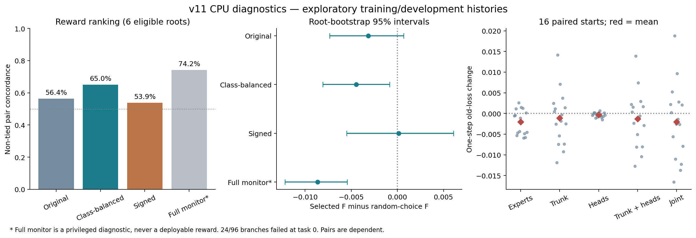
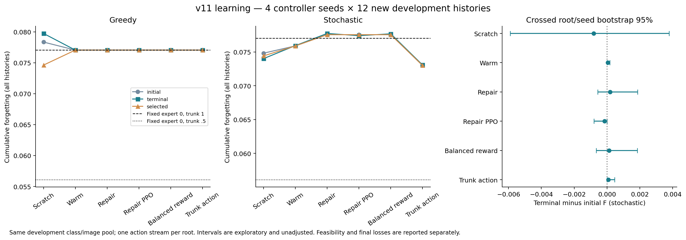

# v11：CPU视觉机制诊断与学习稳定性

运行日期2026-09-18，结果核验与归档2026-09-20；承接v10，旧源码、协议、模型和结果不改。详细数值、失败、轨迹、检查点与成本见本目录results归档。本文只讨论新完成的视觉诊断，不以缺少7B GPU解释视觉负结果。

## 证据范围与先后顺序

1. 只读复核v10现有轨迹，定位奖励排序、动作退化与选中初始化的问题。
2. 新8根×2起点×6分支，完成96条奖励配对分支；同16起点×6种模块范围，完成96条一步及多步干预路径。
3. 另8个开发根扫描6个expert倍率、选中倍率的两档额外trunk倍率，以及只改monitor采样的机制对照，共72条完整历史。
4. 冻结[学习协议](learning_plan.json)，6组×4个控制器种子，每模型12独立训练根×4分支、12轮。检查点0/6/12；8个选择根分别按greedy和stochastic选模；另12根复测初始、末轮和两种执行选中检查点的并集。

训练类0–59，开发类60–79；所有新实验只打开CIFAR训练归档，不打开官方test成员，也不查询80–99类别任务。归档数组整体载入内存不等于用于训练/评价。新根仅改变顺序、初始化和批次流；这些开发类别和图像池已经使用过，不能称新类别最终确认。12复测根不用于选择检查点；新增4个策略种子也不能把同一根上的复测变成独立历史。

旧记忆总预算仍为200（回放100＋监测100），逐样本完成时基准保留；被裁掉的旧样本不能重新拿回。奖励只用保留monitor。诊断器另有完整monitor250和eval500的特权研究访问，完整池从未传给训练控制器或实际reward，成本另记。模型、数据保留在忽略的runs/.cache，压缩数值轨迹进入Git。

## 1. 奖励排序有多可靠？

v10复核得到70/135个非并列成功分支对同序（51.85%）。按代码首个argmin选分支的真实遗忘为0.09115617，随机选择期望0.09147902；若对最小值并列分支取平均，则为0.09170247。必须区分这两个口径。根聚类区间跨零，没有稳定的选择收益证据。seed1001下Feedback GRPO、Progress GRPO、PPO均选中初始化，实际后续expert倍率全部.75，表现矩阵完全相同；合并均值的差异全部来自seed1002，不能解释成稳定的反馈或算法优势。

新诊断有16组、8根、96真实分支，其中24条整序列失败。它们全部来自两个根的首任务失败，在控制器介入前已发生；完整结果保留。下表先报告有成功候选的12组、6根；组内两两比较和重抽样均非独立样本。

| 排序估计 | 非并列同序率 | 选中分支真实F | 均匀随机F | 选择遗憾（相对成功候选特权最优） |
|---|---:|---:|---:|---:|
| 原保留样本正增量 | 56.40%（97/172） | .044178 | .047331 | .007249 |
| 同样本类别均衡估计 | 65.00%（117/180） | .042886 | .047331 | .005957 |
| 同样本signed估计 | 53.89%（97/180） | .047461 | .047331 | .010532 |
| 完整monitor250，仅特权诊断 | 74.16%（132/178） | .038686 | .047331 | .001757 |
| 随机25，20次配对重抽样 | 59.59% | .044193 | .047331 | .007264 |
| 每类5张，共25，20次配对重抽样 | 61.19% | .043828 | .047331 | .006899 |

类别均衡估计在同一有限样本中先求每类平均delta，再对5类均值取正部；缺类时回退原均值。它只改终局reward，不改反馈观测、记忆样本或回放。288个旧任务保留集合均未缺类，但样本数量不平衡。signed去掉正部截断并未改善选择代价，因此未进入学习对照。

类别均衡相对原估计的配对选中F差为−.001292，根bootstrap95%区间[−.004935,+.001618]；分层25相对随机25为−.000364，区间[−.001789,+.001060]。区间都跨零，不能把描述性排序改善称为奖励问题已解决。完整monitor的好表现只说明较大诊断池提供了更一致的排序，不证明它可在200预算内部署。

若纳入全部16组，按实际训练失败惩罚选分支、并列取平均，所有估计的选中整序列达标率都是75%；原估计、均衡估计、signed估计选中F分别.046413、.043840、.048875，均匀随机为.053363。这一口径仍含首任务已失败的历史，不以低F掩盖失败。20次重抽样重复了相同96条轨迹，绝不是1920条新训练分支。

任务级正部截断产生292/720个并列对；合并任务前后的排序问题不同。保留原每任务delta、覆盖数、估计噪声和候选差距，避免用一个总体相关系数代替真实组内选择。任务均值SE与序列候选差距不是同尺度的独立量，不直接拿二者相除声称信噪比。

## 2. 控制expert是否覆盖了主要更新通道？

从同一完整起点产生AdamW候选位移，分别缩放expert、共享trunk（front＋norm）和当前/回放分类头。router参数冻结。零倍率仍推进有梯度参数的矩；16个起点各模式的一步exp_avg校验完全相同。一步位移是可配对干预；多步各自重算梯度和矩，不是可加的因果分解。

| 更新范围 | 一步旧loss变化 | 旧loss上升起点数/16 | 一步当前loss变化 | 一步top-k改变比例 | 当前任务达标/16 | 平均更新数 |
|---|---:|---:|---:|---:|---:|---:|
| 全冻结 | .000000 | 0 | .000000 | 0 | 0 | 200.000 |
| 只expert | −.002059 | 5 | −.010240 | .005719 | 14 | 81.875 |
| 只分类头 | −.000338 | 6 | −.011960 | 0 | 7 | 168.125 |
| 只trunk | −.001125 | 7 | −.009727 | .041875 | 16 | 62.500 |
| trunk＋分类头 | −.001331 | 7 | −.021227 | .041875 | 16 | 55.625 |
| 联合全部 | −.002041 | 7 | −.030369 | .046031 | 16 | 41.250 |

v10两个动态探针中front-only旧损伤为+.02580和+.02410；本轮16个新起点均值未复现这种正号，原两个点不具代表性。共享模块仍显著影响路由和新任务学习速度，只控制expert不足以覆盖这些通道。完全冻结共享部分也会降低当前任务达标率，不能由“共享会改路由”直接推导“共享应冻结”。

多步终点累计F：expert-only .030309、trunk＋头 .029675、联合 .043111；它们的达标率、步数和当前loss不同，不能只按F给出优劣顺序。全冻结终点F仍为.007415，来自起点前已经产生的损伤；没有把累计基准重置为零。

另8个校准根全部6种expert倍率都达标，F随0/.25/.5/.75/1/1.5为.046304/.052994/.056198/.063402/.065773/.077179，因此选expert=0。固定expert0时，trunk=.25只有7/8达标，不因低F选它；trunk=.5和1均8/8达标，F为.043334和.046304，选.5作静态共享基准。学习trunk扩展初始化仍与原修正接口共享trunk1基准，避免同时改变初始静态动作与接口。

校准8根的逐根最佳expert倍率分布为0（4根）、.25（2根）、.5（1根）、1（1根）。特权按根挑选固定expert的平均F为.037519，低于全局expert0的.046304；因此不能由全局0较好推断expert动作完全无用。但这个逐根选择用了研究评价结果，不能直接部署，也不证明在线摘要足以识别最佳倍率。

只改monitor分层保留、固定相同动作时，8根的动作和完整表现矩阵完全相同；机制测试也核对了模型参数、Adam一阶/二阶矩、步数和replay ID。若学习策略读取分层monitor，观测也会改变，因此没有把它混入“纯reward改变”的学习臂。

## 3. 温启动与学习稳定性

六组×4个策略种子全部完成，没有新增轮次或根据复测更换候选。所有初始、选中、末轮策略以及三个固定基准在复测上的整序列达标率均为11/12；四颗种子合计44/48次执行，但仍只有12个根。失败均为root1150010的首任务失败，发生在控制器介入前。不能把配对达标差的退化bootstrap区间[0,0]当作总体可行性的非劣效证明。

| 策略 | greedy初始F | greedy选中F | greedy末轮F | 随机初始F | 随机选中F | 随机末轮F |
|---|---:|---:|---:|---:|---:|---:|
| 从头GRPO | 0.078346 | 0.074624 | 0.079738 | 0.074829 | 0.074427 | 0.074025 |
| 同接口概率温启动 | 0.077048 | 0.077048 | 0.077048 | 0.075903 | 0.075903 | 0.075946 |
| 稀疏修正GRPO | 0.077048 | 0.077048 | 0.077048 | 0.077565 | 0.077565 | 0.077748 |
| 稀疏修正PPO | 0.077048 | 0.077048 | 0.077048 | 0.077565 | 0.077565 | 0.077415 |
| 仅改均衡reward | 0.077048 | 0.077048 | 0.077048 | 0.077565 | 0.077565 | 0.077696 |
| 仅扩展trunk动作 | 0.077048 | 0.077048 | 0.077048 | 0.073010 | 0.073010 | 0.073086 |

F为四个策略种子、12复测根的平均累计遗忘，全部失败保留。选择只使用8个选择根；greedy与随机执行各自锁定检查点。每根一条配对动作随机流，因此随机执行不是高精度策略期望估计。

| 策略 | greedy选中轮次，按1101–1104 | 随机选中轮次，按1101–1104 |
|---|---|---|
| 从头GRPO | [0, 6, 0, 12] | [12, 6, 6, 0] |
| 同接口概率温启动 | [0, 0, 0, 0] | [0, 0, 0, 0] |
| 稀疏修正GRPO | [0, 0, 0, 0] | [0, 0, 0, 0] |
| 稀疏修正PPO | [0, 0, 0, 0] | [0, 0, 0, 0] |
| 仅改均衡reward | [0, 0, 0, 0] | [0, 0, 0, 0] |
| 仅扩展trunk动作 | [0, 0, 0, 0] | [6, 12, 6, 0] |

greedy共22/24选中初始化，随机执行18/24选中初始化。trunk随机策略虽有三颗种子选了训练后的检查点，其复测F仍与初始化完全相同；开发选择的改善没有转移到这些复测路径。

| 策略 | 随机末轮−初始F | 根×策略种子交叉bootstrap95%区间 |
|---|---:|---|
| 从头GRPO | -0.000804 | [-0.005903, +0.003778] |
| 同接口概率温启动 | +0.000043 | [+0.000000, +0.000172] |
| 稀疏修正GRPO | +0.000183 | [-0.000566, +0.001869] |
| 稀疏修正PPO | -0.000151 | [-0.000793, +0.000000] |
| 仅改均衡reward | +0.000131 | [-0.000657, +0.001848] |
| 仅扩展trunk动作 | +0.000076 | [+0.000000, +0.000458] |

所有区间都是开发池上的探索性描述，未作多比较调整；仅4个策略种子且每根一条动作流。大量完全相同轨迹使部分区间退化或端点恰为零，不能解释为确定无效或确定有效。

**温启动解决了初始化分布问题，没有解决本预算内的学习问题。** 同接口温启动的基础模式与条件幅度概率均为.98，完整expert分配保持基准的理论概率为.9224；稀疏修正每层幅度保持基准概率.9，整份分配保持基准概率.81。实际1000次抽样核对了这些概率，而非仅改变argmax。初始概率温启动的greedy确为expert0。四颗种子中，所有温启动/修正组的末轮greedy仍为全expert0、trunk1，复测矩阵与各自初始化完全一致。

在保存的初始随机复测观测上，初始到末轮的精确潜变量KL均值：从头GRPO约.00572–.01913；其他五组约.0000097–.0002615。参数并非不更新，但行为概率移动很小。这里是潜变量KL，不是把多个潜动作合并后的实际分配KL。强概率偏置与12轮、小步长更新共同限制了离开基准的速度；本实验没有分开辨认两者的单独因果作用。稳定地停留在基准不等于学会了协调，也不能把增加历史覆盖本身称为机制修复。

**从头训练有个别收益，未显示稳定协调优势。** greedy选中−初始F为−.003722，交叉区间[−.012616,+.002674]；末轮−初始为+.001392，区间[−.006044,+.010457]。seed1101和1103选中初始化，后续全部expert倍率.25；seed1102选中第6轮，全部倍率0，实际只是找回固定基准；seed1104选中第12轮，在.5和1之间输出20种分配，相对自身初始化改善.004646。不能把前三颗种子的静态动作称为学到的状态协调，也不能把第四颗种子的改善外推为稳定收益。

**奖励与scope的改动尚未变成可复现学习收益。** 同一末轮随机执行中，均衡reward−原修正GRPO为−.000052，区间[−.000193,0]；trunk扩展−原修正GRPO为−.004662，区间[−.012645,+.002205]。trunk较低的平均F已存在于其随机初始化，不能归给训练。PPO−GRPO末轮差约−.000334，区间[−.002001,0]，两者部署选模均保留初始化，未验证稳定算法优势。

实际训练中的成功分支排序同序率为：从头61.75%、温启动60.80%、修正GRPO61.46%、PPO61.46%、均衡reward63.54%、trunk62.50%。各组产生的轨迹不同，不能拿这些比率当纯reward配对比较；排序略好也不保证控制器学得更好。1152训练分支中有355条整序列失败，按上述顺序分别44/64/62/62/62/61（每组192条）；失败全部保留，训练实际采用终局失败惩罚，而非仅在成功子集优化。

## 4. 强静态共享基准与代价

| 固定策略（首任务仍统一倍率1） | 复测达标率 | F | 最终全部任务eval loss | 每任务停止时monitor loss均值 | 平均更新数/历史 |
|---|---:|---:|---:|---:|---:|
| expert0 / trunk1 | 11/12 | 0.077048 | 1.224640 | 1.210672 | 202.50 |
| expert.25 / trunk1 | 11/12 | 0.072158 | 1.219805 | 1.205324 | 187.50 |
| expert0 / trunk.5 | 11/12 | 0.056095 | 1.212438 | 1.216253 | 250.83 |

trunk.5相对trunk1的配对F差为−.020953，根bootstrap95%区间[−.034496,−.002980]；共同达标的11根差为−.017398。12根中11根F下降，一根上升。该静态策略由前8校准根预先选择，复测未重新选幅度。它降低了累计遗忘，也增加约24%的更新；停止时monitor loss略高，虽均按同一1.25目标和检查间隔执行，仍不等于完全相同终点loss的严格匹配。

所有学习策略的选中平均F都高于固定expert0/trunk.5。本轮最清楚的开发发现是共享更新幅度值得纳入基线；未证明需要动态学习才能获得这项收益。校准与选择根偏好的expert0，在复测中也不总优于expert.25，说明固定策略选择同样有历史间波动。

## 5. 本轮结论与下一步边界

- 奖励：原代理存在排序噪声；同样本类别均衡改善了部分诊断，配对不确定性仍大，学习收益未被验证。保留原估计作为对照，不把特权大池替换成部署reward。
- 控制范围：共享trunk是有效且不能忽略的更新通道；已校准静态trunk.5较强，后续动态策略必须与它比较。16起点不支持“共享单步总在损伤旧知识”的说法。
- 学习：概率温启动确实保留了可行基准，但高集中度与小更新预算下行为几乎不动；不能把稳定当作学习成功。若继续视觉工作，应围绕最佳静态共享基准设计可度量的探索/行为变化对照，并预先锁定预算，而非在复测上继续追加轮次。
- 本轮没有新类别最终确认、语言或原生MoE运行，也未证明RL优于充分校准的静态策略。CPU诊断与训练已经实际完成，这些负结果不是由缺少7B GPU推出来的。

## 6. 实际工作量

记录到的learner更新共707,190次：诊断20,150；固定校准11,850；学习阶段含基线675,190（训练分支229,050，训练前缀12,480，开发选择175,140，复测246,960，固定基线11,560）。共3,780条完整历史结果，包含复用前缀的训练/诊断分支，另有96条当前任务scope路径；这些执行数不是独立历史数。

学习阶段1152训练分支、1152选择历史、1248复测历史、60固定基准历史、288次前缀任务执行。24个作业均正常退出，72个检查点保留。3个单线程CPU进程从14:56:11至16:16:42，约80.51分钟；各作业墙钟之和3.94小时，因为并发，不能当作独占CPU算法速度。单作业峰值RSS约921MB。诊断墙钟270.32秒，72条校准轨迹合计141.76秒。

计数不含第一次整数动作调试失败的未记录部分工作，也不含机制测试；因此707,190是有轨迹记账的更新总数，不冒充所有调试计算。特权诊断查询与后处理另记；初始scope测量还读取4000个当前monitor、12000个旧eval样本，这些在每路径差分counter之外，已在工作账本说明。完整账本见results/learning/work_ledger.json。

## 复现与工程记录

先运行audit_v10.py、diagnose.py、analyze_diagnostics.py与calibrate.py，再以learning_plan.json启动launch.py和baselines.py；每次使用新的输出目录。完成后运行policy_audit.py、analyze_learning.py、plot_results.py、archive.py、scripts/verify_v11.py。scripts/test_all.py运行90项机制/历史测试；scripts/verify_artifacts.py核验790历史文件；scripts/verify_v10.py核验旧288条评价轨迹。

校准第一次因固定动作整数tensor类型失败（尚无完整保存轨迹），随后修复为float32；第二次72条完整轨迹全部完成，但最后摘要的numpy.bool序列化失败。现有selection.json由已保存轨迹重建，没有重跑、筛除或替换任何完整校准结果。诊断和学习数值序列化支持numpy标量；这些修复有机制测试。学习开始前固定源码hash，启动时逐文件核对。
