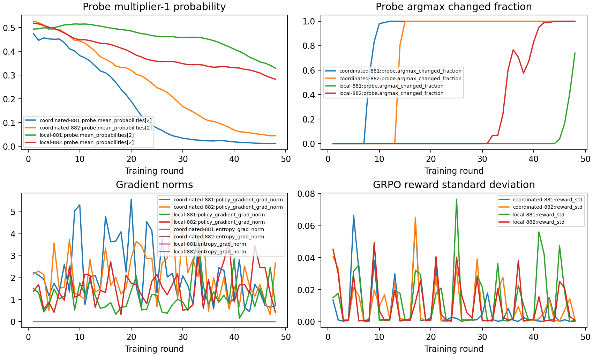

# v11：RL 能改变策略，当前收益主要落在固定保守动作上

完成于 2026-10-09。**把 v8 的训练从 6 轮延长到 48 轮，策略概率和确定性动作确实发生变化。协调控制器在本轮开发历史上改善了达标与遗忘，但其确定性行为与固定零专家位移完全一致，尚未证明逐 expert 动态协调的额外收益。**

本轮回答的是“控制器是否学动、改变了什么”，不是旧任务反馈信息的增益消融，也不是最终泛化确认。

## 做了什么

保持 v8 学习器、奖励、初始化、动作与优化语义不变：两层各 8 个专家，每个动作倍率为 0、0.5、1。局部和协调控制器各用两个策略种子，训练 48 轮，每轮四条配对分支、一次策略更新；保存 0、3、6、24、48 轮的全部 20 个检查点。

训练使用原来的四个训练根，开发使用四个新根 88520–88523，仍来自已反复使用的 25 个开发类别。每个检查点都运行确定性部署及三次配对随机部署，另加六个规则基线，合计 344 条开发轨迹。随机抽样和策略种子先在同一个根内平均，独立历史数仍是四个。没有读取官方 test 或 audit 类图像。

## 为什么以前看起来没学动

1. **损失接近零不等于梯度为零。** 四次训练的奖励策略梯度范数均非零，范围约 0.155–5.571；已乘熵系数的熵梯度范数约 0.000056–0.01261。平均标准化优势会让标量策略损失接近零，但梯度仍会更新参数。
2. **概率先变化，确定性动作后变化。** 固定训练探针上，协调控制器两个种子首次改变 argmax 分别发生在第 8、14 轮，局部控制器在第 45、31 轮。前 6 轮未跨过动作选择边界，不能用它们的相同部署行为推断策略完全没有更新。
3. **单次在策略更新使裁剪未介入。** 全部 192 次更新的重要性倍率均接近 1，裁剪比例为零。这与原算法每组只更新一次相符；本轮不提供 PPO 裁剪效果的比较证据。

两个种子 881 的架构各自与旧 v8 前六轮的奖励、奖励标准差、决策次数和损失精确一致。种子 882 没有旧归档可比。新增仪器化更新还通过了与原算法检查点权重一致的机制测试。

## 闭环结果：相对初始化改善，但没有超过固定零位移

下表只比较预定的确定性部署。F 是序列末旧任务 CE 相对各自初学对角线的正增量平均，包含所有失败历史。在线整序列达标与独立开发样本的最终全部达标分别列出；4/4 在线达标不等于最终全部知识均保留。

| 策略 | 在线整序列达标 | 独立开发最终全部达标 | 平均 F | 平均学习器更新 |
|---|---:|---:|---:|---:|
| 初始化 / 固定全量更新 | 3/4 | 1/4 | 0.134125 | 66.25 |
| 固定半量更新 | 3/4 | 2/4 | 0.156637 | 71.25 |
| 固定零专家位移 | 4/4 | 2/4 | 0.001300 | 63.75 |
| 协调控制器，24 或 48 轮，两个种子分别相同 | 4/4 | 2/4 | 0.001300 | 63.75 |
| 局部控制器，48 轮，种子 881 | 3/4 | 2/4 | 0.012049 | 67.50 |
| 局部控制器，48 轮，种子 882 | 3/4 | 2/4 | 0.156637 | 71.25 |

协调控制器这 16 条确定性轨迹（2 个种子 × 2 个检查点 × 4 个根）的任务记录、实际动作序列、完整 loss/accuracy 矩阵和类别序列，都与对应根的固定零位移基线逐项相同。局部种子 882 的 48 轮部署则全部选择半量更新；种子 881 出现混合动作，但其结果未在另一种子重复。

零专家位移仍训练 CNN 前端和任务头，专家优化器动量也继续推进。低 F 不等于充分学会新任务：固定零位移的独立开发初学和最终全部达标均只有 2/4，最终平均准确率约 38.84%。这里没有“在同等充分学习水平下，学会更优动态协调”的证据。

随机部署结果也完整保留，不能用确定性结果代替：协调控制器 48 轮的根内抽样/种子平均在线达标率为 100%，F 为 0.001657，平均更新 61.88；局部控制器分别为 66.67%、0.179262、76.25。协调随机部署相对固定零位移呈现更少更新、略高 F 的点估计取舍，不能写成同预算优势。它们只有四个开发根，不作显著性或非劣效推断。全部检查点、六个规则和两种部署方式见[完整报告](results/development/analysis/研究诊断报告.md)及[机器可读摘要](results/development/analysis/summary.json)。

## 对下一步的影响

本轮排除了“原来的相同确定性动作足以说明 RL 更新没有发生”的判断，并发现增加训练可以学到本配置中有效的保守动作。尚待解决的是：不同状态是否需要不同专家分配，以及学习策略是否利用了这种差异。

下一轮应先在开发任务上确认：某些状态需要更新一部分专家，而另一些专家需要保护，按状态选择动作确实比统一固定倍率有可用优势。随后加入同训练预算、但不读取状态的可学习动作分布，与逐 expert 控制器比较。这样才能区分“学到整体减少更新”和“学到有用的状态依赖控制”。旧任务反馈消融属于再下一层问题；当前结果没有否定其信息价值，也没有验证其增量收益。

无需为本轮结论启动 GPU；v10 原生语言扩展保持暂缓。所有后续设计必须另锁定预算，不能在这四个开发根上继续挑选结果并称为确认实验。

## 成本与核查

实际运行约 409.2 秒，CPU 单线程。55,510 次物理学习器更新包括：控制器训练 31,675 次，完整开发评价 23,590 次，固定探针参考轨迹 245 次。共享训练前缀只计一次；不同检查点的独立部署均按实际工作计费。另有 825,600 个开发端点评估样本通行，不是官方测试数据，也不是 FLOPs 匹配。

17 项新增机制/分析检查通过；仓库默认共 129 项，通过可选 v10 检查后共 157 项。完整审计核对 344 条唯一评估记录、20 个检查点、23 个探针、来源哈希、旧回放及物理成本。测试和审计验证实现与记录一致性，不替代上述开发实证。

证据：[锁定协议](results/development/locked_protocol.json)、[旧回放校验](results/development/original_replay_check.json)、[完整评价](results/development/evaluations.json)、[成本](results/development/total_cost.json)、[审计](results/development/analysis/audit.json)。
