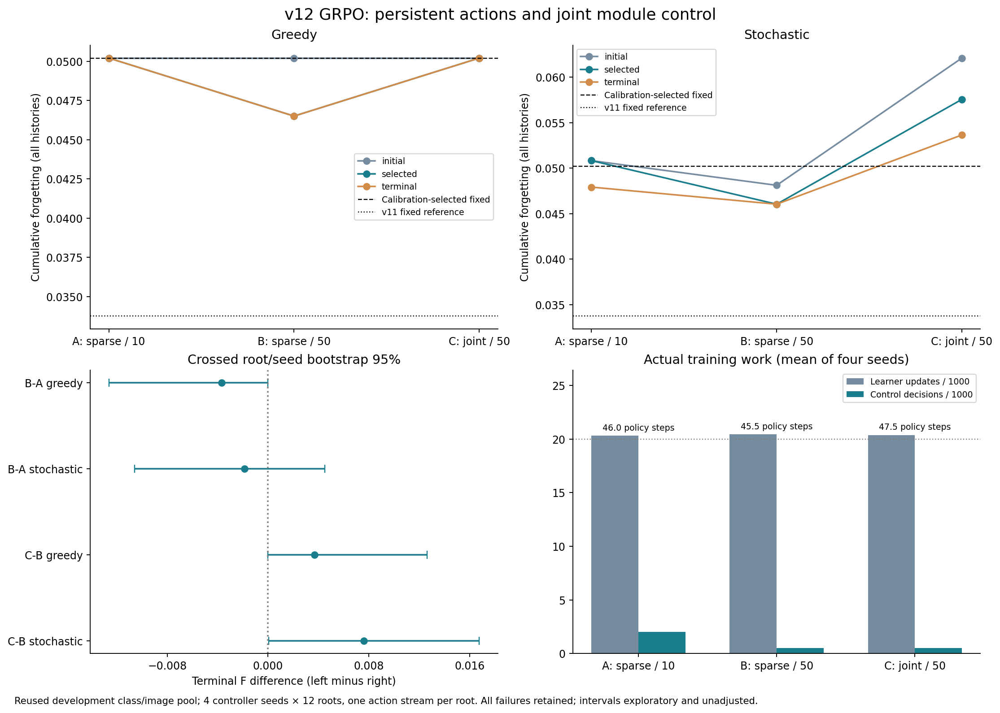

# v12：延长保持与联合控制能否改善 GRPO 学习？

2026-09-20。三组×四种子、12个作业全部完成，只训练GRPO。主训练1,112条分支、244,420次learner更新；含校准、短测、前缀、选择、复测和基线，本轮新增530,410次更新。全部按冻结预算结束，没有按复测结果追加训练。

## 主要发现

**长保持显著减少了决策调用，但本轮没有验证稳定学习收益；放开全部expert联合控制也没有改善复测表现。**

1. **A→B：成本效果明确，遗忘改善不稳。** 实际训练更新合计81,200→81,730，决策8,120→2,030，减少75%。随机执行的选中模型F差为−.004784，95%探索区间[−.016417,+.005880]；末轮差为−.001876，[−.010586,+.004492]。两者都跨零。环境仍每10步监测，在线观测样本没有相应减少，不能宣称总计算加速四倍。
2. **B→C：本轮联合接口的随机结果更差。** 选中模型F由.046043升至.057553，差+.011509，[+.004324,+.019706]；末轮差+.007602，[+.000054,+.016765]。这些是未作多重校正的开发区间，末轮下界接近零。C相对自身较差的随机初始化有描述性改善（末轮−.008446），但区间[−.020697,+.001222]仍跨零；不能把修复初始化探索损伤等同于优于稀疏接口。
3. **没有观察到贪心状态协调。** 12个模型中11个greedy选择初始化。全部末轮模型在各自12个复测根上都只执行一种完整分配。唯一改变的B/1201始终采用expert=.25/trunk=.25，F=.035415：这是学到另一种固定配置，不是状态依赖的联合调度。其余模型始终使用expert=.25/trunk=.5。
4. **强静态参考仍更好，且存在更新成本取舍。** 预先保留的v11固定参考expert=0/trunk=.5复测F=.033779，低于全部组的选中模型均值；它平均207.50次在线更新，B随机选中模型为191.04次，前者约多8.6%。A反馈规则F=.041272也优于A选中模型；B/C未稳定击败各自反馈规则。校准选中的固定策略F=.050198，不能把它称为所有复测静态策略中的最优。
5. **可行性限制仍在。** 全部主要模型和基线均10/12个根整段达标；两个失败来自控制器介入前的首任务。校准8/8没有泛化为90%的目标。新增根仍属于已使用开发类别池，本轮是开发证据。

策略确实训练：278组真实GRPO、556次策略优化，所有模型权重都改变；全部组内reward标准差非零。C末轮随机执行有27.26%的受控更新同时改变超过两expert，联合动作并未被实现限制禁用。另一方面，C/1201固定观测探针执行整份基准的次数从510/1000升至735/1000，与减少探索的行为一致。缺乏信息消融和同等随机性下的静态混合对照，不能把随机分布变化直接归因为使用反馈的收益。

图中selected按选择根锁定。部分greedy曲线完全重合；误差线只用于预定末轮轮内比较，区间均为探索性。

## 实际运行的问题

| 组 | 可以改变的模块 | 动作保持 |
|---|---|---:|
| A | trunk＋每层至多1个expert，其余保持校准基础倍率 | 10次learner更新 |
| B | 与A相同 | 50次learner更新 |
| C | trunk＋全部8个expert，各倍率均可变化 | 50次learner更新 |

三组使用相同的局部/层级/全局共享编码器、同一潜变量探索层级、相同奖励与学习率。A→B在轮内检验保持长度；B→C改变联合动作支持，也改变探索的扰动幅度，不能解释为纯动作维数效应。A并非逐字复跑v11：新的基础倍率、结构化探索先验、策略学习率和预算三组共用。因此不把跨版本差异归因于单一改动。

所有组每10步检测同一新任务monitor目标loss≤1.25，每任务最多200更新。保持期间仍刷新环境摘要，但不调用策略；提前达标时立即终止剩余保持区间。GRPO每次实际采样只记录一次transition，长动作不会被复制成五个决策。实际保持长度及动作按更新数加权的分布另报。

控制器缩放的是AdamW候选的完整参数位移，包含weight decay；有梯度的零倍率参数仍推进Adam矩，grad=None遵循AdamW跳过语义。trunk包含前端与LayerNorm；头倍率固定1，router权重冻结但输入表示变化，所以样本路由仍可变化。每层4个expert、两层、top-2、宽度48；每条历史4个五分类任务，保留旧记忆总预算200（回放100、monitor100）。这不是大语言模型或训练router的验证。

## 基础策略与探索确实覆盖联合动作

校准补齐6个expert倍率×3个trunk倍率的18组静态候选，各8根。先在真实数据上检查一条v11固定路径逐数一致，再复用64条既有结果、新增80条；复用数据不计新增计算。按达标率、F、最终loss的字典序选中expert=.25/trunk=.5，校准8/8达标，F=.038345。次优expert=.25/trunk=.25的F=.040732；v11固定参考expert=0/trunk=.5为.043334。随后锁定初始化，不按复测结果重新选择。

初始化先以.5概率保留整份基准，以.5概率进入探索；探索依次抽trunk、跨层共享expert锚点、层级模式、局部倍率。层级/局部以.8概率跟随上级模式，因此不是九个互不相关的开关。A/B各层只抽一个修正对象，C为全部expert抽倍率；完整链式联合log概率进入GRPO。同一实际动作可以由多个潜路径得到，记录和优化的是潜变量策略概率，不能将某一潜路径的概率当作合并后的动作概率。

独立真实数据短测中，每组1000次采样：A/B有555次实际执行整份基准、211次同时改变trunk和expert，且没有超出两expert的动作；C有510次执行整份基准、381次改变超过两expert、171次同时改变全部8个expert，234次同时改变trunk和expert。C已获得充分联合探索支持，不能把负结果简单解释为接口仍限制每层只改一个expert。三组均完成4条真实分支、两次策略更新且参数改变后，才锁定主运行。

## 评价、筛选和统计语义

复测根1250001和1250010在控制器尚未介入的首任务失败。首任务路径在所有组一致，所以本协议的整段达标率上限为10/12（83.33%）；选择根也有一个首任务失败。校准8/8可行没有在新根上保持90%的目标，不能称完成稳定可行性验证。不能删除失败根来宣称整体可行；共同成功子集只回答条件性的遗忘比较。

每组4个控制器种子，共12个模型；每模型从12个相同训练根的完整首任务前缀中循环抽取起点，每组克隆4条真实后续轨迹。以20,000个分支learner更新为训练目标，完成首次跨越目标的整组后停止；中间检查点同样在首次跨10,000后保存。不同保持长度可以改变达标所需更新，所以优化次数、轨迹数与根覆盖不强制相同，必须随实际成本报告。本轮每模型实际20,000–20,630更新，最大预算超出3.15%；执行22–24个GRPO组、44–48次策略优化。12个根各至少访问一次，最后1–2个根是否第二次访问取决于预算何时耗尽。因此比较匹配的是近似learner更新预算，并非完全相同的策略优化或根重复次数。

8个选择根分别为贪心/随机执行选检查点，候选是initial、mid、terminal；12个复测根运行initial、terminal及选中检查点的并集。选择仅使用选择根，复测不改变训练预算。选中的initial不是“训练后进步”；terminal结果也单列，以免筛选隐藏学习退化。随机执行每根只有一条固定动作流，不是对策略期望的精密估计。接口的潜变量数量不同，共享动作随机种子不意味着每个潜动作逐一配对。

累计F为末任务结束时，前三个任务的独立eval交叉熵相对各自完成时固定基准的正增量均值；不是准确率下降百分比，也不将负遗忘抵消正遗忘。最终loss是最后模型在全部四任务的eval交叉熵均值；停止时monitor loss与这个独立eval loss不是同一个指标。达标率要求全部四任务都在各自完成时达到monitor目标，不保证最终仍全部达标。奖励仅使用有限旧monitor累计正增量及失败任务罚分，完整研究eval矩阵不进入策略或优势计算。

比较保留失败历史，并单列共同成功历史的F差。区间对四个控制器种子与十二个根分别重采样，是未作多重比较调整的探索性crossed bootstrap 95%区间。48次执行不等于48个独立数据根；相同成功模式导致的零宽区间不证明可行性非劣效。若动作随状态变化，也仅是行为变化，不能凭此证明反馈信息有效，仍需同接口信息消融。

## 四种子的复测结果

| 组 | 执行 | 检查点 | 全任务达标 | F | 最终loss | 更新/历史 | 决策/历史 |
|---|---|---|---|---|---|---|---|
| A | greedy | initial | 40/48 | 0.050198 | 1.203528 | 188.33 | 12.25 |
| A | greedy | selected | 40/48 | 0.050198 | 1.203528 | 188.33 | 12.25 |
| A | greedy | terminal | 40/48 | 0.050198 | 1.203528 | 188.33 | 12.25 |
| A | stochastic | initial | 40/48 | 0.050827 | 1.205008 | 182.50 | 11.67 |
| A | stochastic | selected | 40/48 | 0.050827 | 1.205008 | 182.50 | 11.67 |
| A | stochastic | terminal | 40/48 | 0.047920 | 1.200012 | 183.96 | 11.81 |
| B | greedy | initial | 40/48 | 0.050198 | 1.203528 | 188.33 | 3.67 |
| B | greedy | selected | 40/48 | 0.046502 | 1.201594 | 195.00 | 3.75 |
| B | greedy | terminal | 40/48 | 0.046502 | 1.201594 | 195.00 | 3.75 |
| B | stochastic | initial | 40/48 | 0.048118 | 1.198045 | 188.33 | 3.67 |
| B | stochastic | selected | 40/48 | 0.046043 | 1.197975 | 191.04 | 3.67 |
| B | stochastic | terminal | 40/48 | 0.046043 | 1.197975 | 191.04 | 3.67 |
| C | greedy | initial | 40/48 | 0.050198 | 1.203528 | 188.33 | 3.67 |
| C | greedy | selected | 40/48 | 0.050198 | 1.203528 | 188.33 | 3.67 |
| C | greedy | terminal | 40/48 | 0.050198 | 1.203528 | 188.33 | 3.67 |
| C | stochastic | initial | 40/48 | 0.062091 | 1.208770 | 185.83 | 3.58 |
| C | stochastic | selected | 40/48 | 0.057553 | 1.205192 | 187.08 | 3.65 |
| C | stochastic | terminal | 40/48 | 0.053645 | 1.200209 | 188.12 | 3.71 |

selected由选择根确定。initial和terminal在每个模型都复测；表中更新包含首任务。

| 组 | 种子 | greedy选择 | greedy选择F | 随机选择 | 随机选择F | 末轮greedy动作种类 | 末轮greedy trunk更新数 |
|---|---|---|---|---|---|---|---|
| A | 1201 | initial | 0.050198 | initial | 0.050827 | 1 | {'0.5': 1470} |
| A | 1202 | initial | 0.050198 | initial | 0.050827 | 1 | {'0.5': 1470} |
| A | 1203 | initial | 0.050198 | initial | 0.050827 | 1 | {'0.5': 1470} |
| A | 1204 | initial | 0.050198 | initial | 0.050827 | 1 | {'0.5': 1470} |
| B | 1201 | terminal | 0.035415 | terminal | 0.046564 | 1 | {'0.25': 1790} |
| B | 1202 | initial | 0.050198 | terminal | 0.045100 | 1 | {'0.5': 1470} |
| B | 1203 | initial | 0.050198 | terminal | 0.048966 | 1 | {'0.5': 1470} |
| B | 1204 | initial | 0.050198 | terminal | 0.043543 | 1 | {'0.5': 1470} |
| C | 1201 | initial | 0.050198 | mid | 0.057745 | 1 | {'0.5': 1470} |
| C | 1202 | initial | 0.050198 | terminal | 0.057385 | 1 | {'0.5': 1470} |
| C | 1203 | initial | 0.050198 | initial | 0.062091 | 1 | {'0.5': 1470} |
| C | 1204 | initial | 0.050198 | terminal | 0.052990 | 1 | {'0.5': 1470} |

## 预定轮内比较

| 比较 | 执行 | 检查点 | F差及95%区间 | 达标率差 | 最终loss差 | 更新差 | 共同成功F差 |
|---|---|---|---|---|---|---|---|
| B-A | greedy | selected | -0.003696 [-0.012633, +0.000000] | +0.0000 | -0.001934 | +6.67 | -0.004383 |
| B-A | greedy | terminal | -0.003696 [-0.012633, +0.000000] | +0.0000 | -0.001934 | +6.67 | -0.004383 |
| B-A | stochastic | selected | -0.004784 [-0.016417, +0.005880] | +0.0000 | -0.007032 | +8.54 | -0.004595 |
| B-A | stochastic | terminal | -0.001876 [-0.010586, +0.004492] | +0.0000 | -0.002037 | +7.08 | -0.002340 |
| C-B | greedy | selected | +0.003696 [+0.000000, +0.012633] | +0.0000 | +0.001934 | -6.67 | +0.004383 |
| C-B | greedy | terminal | +0.003696 [+0.000000, +0.012633] | +0.0000 | +0.001934 | -6.67 | +0.004383 |
| C-B | stochastic | selected | +0.011509 [+0.004324, +0.019706] | +0.0000 | +0.007216 | -3.96 | +0.013023 |
| C-B | stochastic | terminal | +0.007602 [+0.000054, +0.016765] | +0.0000 | +0.002233 | -2.92 | +0.008334 |

F差为左减右，负值更好；所有区间探索性且未校正多重比较。

| 组 | 执行 | 选中−初始化F差 | 末轮−初始化F差 | 选中−v11固定参考F差 |
|---|---|---|---|---|
| A | greedy | +0.000000 [+0.000000, +0.000000] | +0.000000 [+0.000000, +0.000000] | +0.016419 [+0.007256, +0.026563] |
| A | stochastic | +0.000000 [+0.000000, +0.000000] | -0.002907 [-0.009964, +0.002842] | +0.017048 [+0.006402, +0.028749] |
| B | greedy | -0.003696 [-0.012633, +0.000000] | -0.003696 [-0.012633, +0.000000] | +0.012723 [+0.003312, +0.023858] |
| B | stochastic | -0.002075 [-0.010424, +0.005941] | -0.002075 [-0.010424, +0.005941] | +0.012264 [+0.007208, +0.017511] |
| C | greedy | +0.000000 [+0.000000, +0.000000] | +0.000000 [+0.000000, +0.000000] | +0.016419 [+0.007256, +0.026563] |
| C | stochastic | -0.004538 [-0.014715, +0.002493] | -0.008446 [-0.020697, +0.001222] | +0.023774 [+0.014554, +0.033850] |

## 固定与规则基准

| 策略 | 全任务达标 | F | 最终loss | 更新/历史 | 决策/历史 | 任务0–3失败数 |
|---|---|---|---|---|---|---|
| fixed_best | 10/12 | 0.050198 | 1.203528 | 188.33 | 3.67 | [2, 0, 0, 0] |
| fixed_v11 | 10/12 | 0.033779 | 1.193330 | 207.50 | 4.08 | [2, 0, 0, 0] |
| fixed_trunk1 | 10/12 | 0.065697 | 1.208356 | 165.83 | 3.33 | [2, 0, 0, 0] |
| A_progress | 10/12 | 0.056212 | 1.203004 | 179.17 | 11.33 | [2, 0, 0, 0] |
| A_feedback | 10/12 | 0.041272 | 1.195557 | 180.83 | 11.50 | [2, 0, 0, 0] |
| B_progress | 10/12 | 0.067974 | 1.210405 | 162.50 | 3.33 | [2, 0, 0, 0] |
| B_feedback | 10/12 | 0.047346 | 1.198519 | 171.67 | 3.42 | [2, 0, 0, 0] |
| C_progress | 10/12 | 0.062437 | 1.200491 | 152.50 | 3.33 | [2, 0, 0, 0] |
| C_feedback | 10/12 | 0.051885 | 1.194560 | 162.50 | 3.33 | [2, 0, 0, 0] |

fixed_best为校准选中的expert=.25/trunk=.5；fixed_v11为expert=0/trunk=.5；fixed_trunk1为expert=.25/trunk=1。规则的动作接口、保持长度分别与A/B/C对应。固定策略每50步记录一次分配，但它不依据状态改变。

## 真实行为与训练成本

| 组 | 种子 | 整份基准动作 | 超过两expert变化 | 同时改变trunk与expert |
|---|---|---|---|---|
| A | 1201 | 555/1000 → 560/1000 | 0/1000 → 0/1000 | 211/1000 → 195/1000 |
| A | 1202 | 555/1000 → 556/1000 | 0/1000 → 0/1000 | 211/1000 → 210/1000 |
| A | 1203 | 555/1000 → 556/1000 | 0/1000 → 0/1000 | 211/1000 → 210/1000 |
| A | 1204 | 555/1000 → 548/1000 | 0/1000 → 0/1000 | 211/1000 → 208/1000 |
| B | 1201 | 555/1000 → 321/1000 | 0/1000 → 0/1000 | 211/1000 → 359/1000 |
| B | 1202 | 555/1000 → 574/1000 | 0/1000 → 0/1000 | 211/1000 → 230/1000 |
| B | 1203 | 555/1000 → 553/1000 | 0/1000 → 0/1000 | 211/1000 → 166/1000 |
| B | 1204 | 555/1000 → 637/1000 | 0/1000 → 0/1000 | 211/1000 → 196/1000 |
| C | 1201 | 510/1000 → 735/1000 | 381/1000 → 206/1000 | 234/1000 → 152/1000 |
| C | 1202 | 510/1000 → 602/1000 | 381/1000 → 310/1000 | 234/1000 → 169/1000 |
| C | 1203 | 510/1000 → 518/1000 | 381/1000 → 373/1000 | 234/1000 → 225/1000 |
| C | 1204 | 510/1000 → 519/1000 | 381/1000 → 391/1000 | 234/1000 → 209/1000 |

此表在同一个首任务前缀观测上各抽1000次，比较初始化与末轮策略分布；它是固定观测探针，不是全部实际部署状态的平均。

| 组 | 种子 | 分支更新 | GRPO组 | 分支数 | 决策数 | 优化步 | 平均保持 | 组reward标准差范围 | 训练任务0–3失败数 |
|---|---|---|---|---|---|---|---|---|---|
| A | 1201 | 20270 | 23 | 92 | 2027 | 46 | 10.00 | 0.0512–1.4994 | [0, 18, 8, 0] |
| A | 1202 | 20400 | 23 | 92 | 2040 | 46 | 10.00 | 0.0739–1.6628 | [0, 19, 7, 0] |
| A | 1203 | 20210 | 23 | 92 | 2021 | 46 | 10.00 | 0.0474–1.3681 | [0, 17, 8, 0] |
| A | 1204 | 20320 | 23 | 92 | 2032 | 46 | 10.00 | 0.0530–1.3983 | [0, 18, 8, 0] |
| B | 1201 | 20630 | 23 | 92 | 514 | 46 | 40.14 | 0.0869–1.4532 | [0, 22, 8, 1] |
| B | 1202 | 20570 | 23 | 92 | 510 | 46 | 40.33 | 0.0349–1.4593 | [0, 18, 8, 0] |
| B | 1203 | 20530 | 23 | 92 | 510 | 46 | 40.25 | 0.0172–1.7159 | [0, 22, 7, 0] |
| B | 1204 | 20000 | 22 | 88 | 496 | 44 | 40.32 | 0.0410–1.2162 | [0, 19, 7, 0] |
| C | 1201 | 20450 | 24 | 96 | 518 | 48 | 39.48 | 0.0606–1.5123 | [0, 18, 7, 0] |
| C | 1202 | 20330 | 24 | 96 | 521 | 48 | 39.02 | 0.0806–1.7650 | [0, 19, 4, 0] |
| C | 1203 | 20500 | 24 | 96 | 523 | 48 | 39.20 | 0.0847–1.3766 | [0, 20, 2, 0] |
| C | 1204 | 20210 | 23 | 92 | 506 | 46 | 39.94 | 0.0499–1.5993 | [0, 19, 7, 0] |

| 组 | 训练分支更新合计 | 决策合计 | 训练分支在线观测样本 | 训练分支研究eval样本 | 状态复制 | 记录复制秒数 |
|---|---|---|---|---|---|---|
| A | 81200 | 8120 | 3292814 | 2208000 | 368 | 2.353 |
| B | 81730 | 2030 | 3306419 | 2184000 | 364 | 2.457 |
| C | 81490 | 2068 | 3317768 | 2280000 | 380 | 2.543 |

保持长度减少策略调用，不取消每10步环境观测。不同组的观测总量还受实际更新与分支数量影响；不能把决策减少比例解释为同等比例的总运行加速。

| 组 | 末轮执行 | 平均实际保持 | 基准动作更新占比 | 超过两expert变化更新占比 | 保持长度:决策数 |
|---|---|---|---|---|---|
| A | greedy | 10.00 | 100.00% | 0.00% | {'10': 588} |
| A | stochastic | 10.00 | 59.08% | 0.00% | {'10': 567} |
| B | greedy | 34.44 | 71.13% | 0.00% | {'50': 58, '20': 32, '30': 55, '10': 13, '40': 22} |
| B | stochastic | 34.15 | 56.24% | 0.00% | {'50': 52, '10': 8, '30': 47, '20': 42, '40': 27} |
| C | greedy | 33.41 | 100.00% | 0.00% | {'50': 52, '10': 16, '40': 20, '30': 56, '20': 32} |
| C | stochastic | 32.98 | 62.52% | 27.26% | {'50': 52, '10': 15, '30': 36, '20': 48, '40': 27} |

## 新增计算账本

| 阶段 | 历史/前缀数 | learner更新 | 控制决策 | 在线观测样本 | 研究eval样本 | 完整状态复制 |
|---|---|---|---|---|---|---|
| calibration_new | 80 | 13190 | 309 | 556017 | 640000 | 0 |
| reuse_parity | 1 | 180 | 4 | 7679 | 8000 | 0 |
| smoke_prefix | 1 | 20 | 0 | 850 | 2000 | 0 |
| smoke_branches | 12 | 2120 | 105 | 88926 | 72000 | 12 |
| training_prefixes | 144 | 6240 | 0 | 206400 | 288000 | 0 |
| training_branches | 1112 | 244420 | 12218 | 9917001 | 6672000 | 1112 |
| development | 576 | 118710 | 4435 | 4718068 | 4608000 | 0 |
| audit | 600 | 112810 | 3801 | 4500974 | 4800000 | 0 |
| baselines | 180 | 32720 | 1008 | 1315098 | 1440000 | 0 |

本轮新增完整历史结果2,561份（训练分支共享首任务前缀），另有145条实际执行的首任务前缀；总learner更新530,410次。复用v11的64条历史及10,510次旧更新不重复收费。主训练策略优化556步、短测6步；覆盖检查共27,000次纯策略采样，无learner更新。

另计覆盖探针15次复制、5,250个在线观测样本。因此新计算总观测21,316,263样本、研究eval 18,530,000样本、训练及回放23,940,160样本、完整状态复制1,139次。记录的分支复制用时7.38秒，15个探针复制用时未保存。

学习启动器墙钟70.63分钟；三并发单线程CPU作业的作业墙钟相加为209.85分钟，不能当作真实经过时间或进程CPU时间。基线在早期作为第四进程重叠。最大单进程RSS 740.5 MiB，不是实测总峰值。36个控制器检查点均留在本地并记录SHA256。计数是工作量代理，不是FLOPs；机制测试与概率回放另列。

## 数据、复现与结论范围

训练任务查询类别0–59；本轮校准、选择和复测都在已多轮使用的开发类别60–79。新root只是顺序/初始化开发复测，图像和类别池没有重新独立。只打开官方train归档成员；不查询80–99任务或官方test成员。完整训练数组装入内存和实际任务样本查询分开陈述。本轮不能称最终确认，也不能据此断言GRPO最优、算法无关，或联合控制原则本身无效。

全量核验通过151个归档数据/日志文件与2,561份新增完整历史结果；8,236条评价决策的动作与联合log概率回放误差为零。详细计数见[工作账本](results/learning/work_ledger.json)，权重见[模型清单](results/learning/model_manifest.json)，全部配对统计见[分析JSON](results/learning/analysis.json.gz)。

协议及七个运行源码hash见[plan.json](plan.json)，详细接口与入口见[README](README.md)，机制与归档核验见[验证记录](../../docs/v12-validation.md)。权重留在本地runs目录；Git保留压缩轨迹、矩阵、观测、行为概率、模型hash、账本与图表。v10、v11及更早版本保持冻结。
