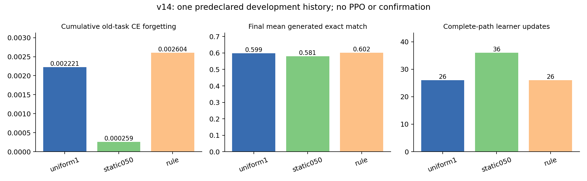
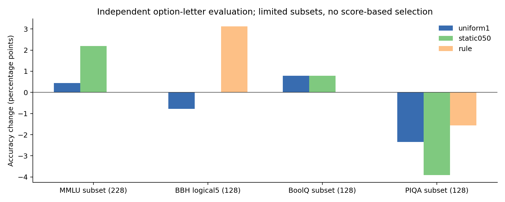

# v14：全层 expert LoRA 接入与有限开发比较

2026-09-20完成。全16层原生OLMoE、1024个expert、3072个投影的rank4 LoRA已通过真实A800机制验证，共37,748,736可训练参数；原始6,919,161,856参数始终冻结。本轮验证了平台可运行，尚未验证学习控制器收益。没有训练PPO，没有正式强静态校准，也没有新确认集实验。

## 同一开发根的三条路径

预先锁定DREAM→SNLI→FinancialPhrasebank、共享A前缀、目标和停止规则。三条路径全部达标；参考目标的90步训练仅用于设定目标，不能加入候选排名。

| 方法 | 旧任务正CE遗忘F↓ | 最终平均CE↓ | 最终生成EM↑ | 完整路径更新 | 新执行分支更新 | 控制决策 |
|---|---:|---:|---:|---:|---:|---:|
| 固定1 | .002221 | .386994 | .598958 | 26 | 6 | 2 |
| 固定.5 | .000259 | .358173 | .580729 | 36 | 16 | 4 |
| 同信息规则 | .002604 | .386209 | .601563 | 26 | 6 | 2 |

固定.5的F最低，但多用10次更新，平均生成EM也较低。规则相对固定1的F增加.000382，未显示该指标上的改善。固定.5只是预先声明的候选，不能称已校准的强静态基线；PPO和克隆诊断的未执行指标保留为空。

F是旧任务相对各自完成时CE上升的正部均值。三路径有符号CE变化分别为−.042144、−.043080、−.049381，反映部分旧任务改善，不能用来掩盖其他任务退化。例如固定1的A生成EM从.671875降至.6328125（下降5/128），即便其CE遗忘很小；B的EM则从.3671875升至.515625。完整CE、EM、token-F1下三角及逐项结果保存在原始记录中。

只有一个已用开发根、每条2/4/2个控制决策，不能推断多根稳定性、长程控制收益或全层优于两层的因果效果。没有根据结果追加候选或调难停止目标。

## 独立通用评价

始终开启部署适配器，在共享初始状态及三个终点进行零样本选项条件概率评价。612个不同条目共计2448次评分；包括MMLU每学科4题共228题，以及BBH单一logical-deduction-five-objects、BoolQ、PIQA各128题。分数未进入奖励、目标或候选选择。

| 子集 | 初始准确率 | 固定1 | 固定.5 | 规则 |
|---|---:|---:|---:|---:|
| MMLU | 49.12% | 49.56% | 51.32% | 49.12% |
| BBH logical5 | 21.09% | 20.31% | 21.09% | 24.22% |
| BoolQ | 39.06% | 39.84% | 39.84% | 39.06% |
| PIQA | 75.78% | 73.44% | 71.88% | 74.22% |

所有方法的所有能力子集，正确答案原始NLL都高于初始值。例如PIQA由.917585变为1.165093/1.179330/1.158980；BBH由2.757313变为4.433866/4.405442/4.437047。部分准确率增加不等于通用能力整体保持。小子集、单一BBH任务、无CoT及偏低的BoolQ初始准确率限制解释；不据此重调提示或宣称显著收益。完整NLL、准确率和配对逐项数据见[通用表](analysis/short_comparison/general.csv)。这不是完整MMLU或TRACE复现。

数据在打分前与全部40个已选NI任务、35,840个条目进行来源身份、规范化完全匹配和5-shingle Jaccard≥.90审计。未发现所定义的重合，2题因长度排除；不能据此排除语义重复、共同网页来源或预训练污染。若后续依据这些结果开发方法，应另用未查询确认数据。来源、锁定规则和限制见[评价协议](EVALUATION_PROTOCOL.md)。

## 机制、成本与可恢复性

零B初始化时适配器开启/关闭logits逐位一致；m=0保留已学前向且不移动因子；m=1匹配原AdamW候选；混合倍率最大误差1.46e−11。六个A/B因子共享expert倍率，门控真实AdamW位移，moment按有梯度的标准语义推进。基座前后SHA一致。BA有效权重变化不被错误解释为线性倍率。

seq512、当前micro2、replay micro1的短测为3.625秒/更新，峰值allocated17.20GiB；micro1为3.528秒、15.44GiB。窗口包含监测，不能与v13不同配置直接比较。路由增量计时受噪声影响，不宣称免费统计。459.9MB完整恢复检查点实测保存1.381秒、加载恢复2.199秒，权重、Adam矩和CPU/CUDA RNG完全恢复；未实际触发硬截止中断。该短测检查点验证后删除。

比较工作流1933.75秒（监督进程墙钟1936.75秒），共138次真实更新：目标参考90、共享A20、三个分支6+16+6；加机制短测12次，v14合计150次，连同v13共321次。共享前缀不重复计费。三条完整逻辑路径含初始/终点通用评价分别587.71、624.83、588.14秒，额外分支分别389.38、426.50、389.81秒；模型加载、保存和hash等额外开销计入总工作流。

观测和评价是主要时间成本：监测511.19秒、任务CE评价188.87秒、生成616.76秒、通用评价163.71秒。训练前向84.43秒、反向119.40秒、replay前向53.10秒、反向78.31秒、optimizer60.64秒。嵌套观测计时不能再次相加。详见[成本表](analysis/short_comparison/costs.csv)、[资源说明](RESOURCE_NOTES.md)及[分配账本](allocation_ledger.json)。截至08:02:53 UTC分配已过2小时37分53秒；监督任务墙钟合计约50分13秒，不等于GPU忙碌时间。

四个adapter-only文件已下载到本地忽略目录，SHA、结构与有限值经核验，见[检查点索引](checkpoint_index.json)。这些部署文件没有Adam状态，不能用于精确继续训练。独立评价入口为evaluate_checkpoint.py；基座仍使用锁定版本。

全部GPU工作在08:00:12 UTC完成，最终状态无活动/排队任务，GPU为0MiB/0%。实例未关闭，原监督器与硬截止保护保留；13:25 UTC原截止不重置。没有追加训练或购买资源。正式多根校准与PPO需要新的范围和预算决定。

## 核验与复现

[原始结果](archive/results/short_comparison/summary.json)、[分析表](analysis/short_comparison/main.csv)、[机制短测](smoke_result.json)、[核验摘要](validation_summary.json)和archive_manifest.json共同保留证据。执行时源码位于archive/provenance，后续分析/下载固定/部署加载入口与执行版本分开记录。CPU机制测试16项通过，实际轨迹8个决策回放、18个矩阵单元及通用分数聚合核验通过；这些离线核验不等于重新运行GPU生成。
