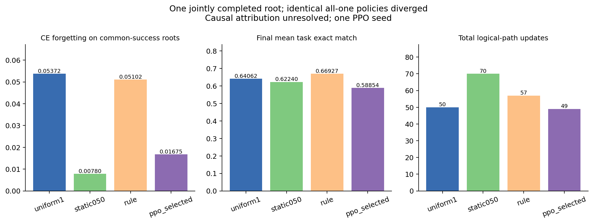
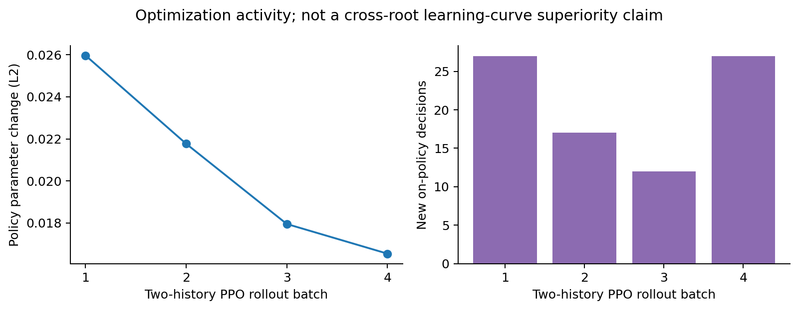

# v14同平台固定／规则／PPO方法实验

2026-09-20完成有界执行与归档。单种子PPO完成8条新轨迹、83个控制决策、4个rollout批次、12个优化梯度步；确认实际完成7/8条路径。**本轮没有建立PPO控制收益，也不能据固定／规则的单次数值差异宣称稳健优势。** 冻结greedy PPO的动作函数恒为倍率1，但它与固定1在第一确认根出现不同学习轨迹，原因仍未定位。这是结果归因的限制，不能把较小的PPO遗忘直接算作策略收益。

原先“今日不训练PPO”的限定已由用户新指令覆盖；本次仍使用既有全16层×64原生expert rank4 LoRA、37,748,736因子参数、冻结原模型/router。H=5、共享分层base＋0/1/2个expert修正、五档实际AdamW位移倍率保持固定。08:17:16 UTC锁定[协议](method_protocol.json)，此前单根pilot在提交4e863b1冻结，没有回写其结果。

## 实际确认主表

所有已完成路径均达标。F为相对每个旧任务完成时、终点CE上升正部的均值；CE和EM为终点三个任务的绝对平均值。更新数为含共享A前缀的完整逻辑路径。

| 确认根 | 方法 | 状态 | F↓ | 最终平均CE↓ | 最终生成EM↑ | 路径更新 |
|---|---|---|---:|---:|---:|---:|
| 1412000 | 固定1 | 达标 | .053717 | .289582 | .640625 | 50 |
| 1412000 | 固定.5 | 达标 | .007803 | .247871 | .622396 | 70 |
| 1412000 | 同信息规则 | 达标 | .051025 | .289963 | .669271 | 57 |
| 1412000 | PPO greedy | 达标 | .016751 | .265317 | .588542 | 49 |
| 1412001 | 固定1 | 达标 | .072349 | 1.197325 | .356771 | 59 |
| 1412001 | 固定.5 | 达标 | .003917 | 1.122985 | .312500 | 92 |
| 1412001 | 同信息规则 | 达标 | .087905 | 1.219477 | .348958 | 57 |
| 1412001 | PPO greedy | **时间预算缺失** | — | — | — | — |

四方法共同完成且达标的实跑根数为 **n=1**；固定1、固定.5和规则各为 **n=2**。第二根PPO恢复A前缀后，在任何分支更新之前触发预算保护；这不是learner未达标，也不是第二条PPO确认已完成。greedy等价证书不替代这条缺失实跑。

描述性地，固定.5在两根的F均较低，但分别多用20、33次更新，EM也较固定1低。它是已有开发根上在固定1/.5两项菜单中的选择，不是全局最优静态策略。规则在第一根F略低、第二根更高。固定／规则方向同样可能受到下述执行变异影响；样本量和异常都不足以支持稳健效果。逐任务CE/EM/F1、完整下三角、失败计数及成本见[分析表](analysis/main.csv)、[逐任务表](analysis/tasks.csv)和[原始确认记录](archive/results/confirmation)。

## 为什么不能把PPO数值差异归因于控制

最终控制器8458个参数确实经过优化。但共享网络末层tanh限制了动作头输入，冻结权重的区间核验给出：倍率1相对其他base的最小logit间隔下界3.52646，零修正相对1/2修正的下界2.85809。合法因子的均匀epsilon混合保持argmax，因此对所有具有有限actor激活的合法观测，greedy动作都为每层base1、零修正。随机训练动作分布仍可不同，证书仅针对锁定的greedy部署。见[证书](greedy_certificate.json)。

第一根确认的固定1与PPO实际记录均全倍率1、使用同一缓存prefix SHA，却分别走50/49次更新。B任务第一步后的监测CE已为.445335/.431232。两条记录的初始B loss均.487456，但该初值来自prefix缓存，不是每次恢复后的新测值；旧prefix标签也不是每次恢复前重新计算的完整状态hash。因而不能据这些标签宣称两个物理执行起点已逐项验证相同，也不能擅自把差异定性为某一种GPU非确定性。

经单独授权，使用现存第二根A前缀可恢复checkpoint进行了fixed/fixed/PPO/PPO四次单步复现，新增4次learner更新，耗时106.37秒（监督墙钟110.04秒）。四次恢复后的权重、完整Adam step/矩、RNG一致；输入checkpoint对象hash未改变，actor调用未改变RNG；四次结束权重和矩逐位一致，监测CE均1.996362254。该fixture未复现异常，也没有发现其snapshot原位污染。**它不是原第一根的重放，不能消除原异常。** 原第一根的完整prefix对象未持久化，已结束的原进程无法补取。模型attention dropout为0，安装的MoE前向没有jitter注入；SDPA/融合优化器等潜在数值因素尚未被定位为成因。详见[异常记录](execution_anomaly.json)、[独立调试证据](debug_restore/result.json)。

本轮因此保留真实观测，但不报告“PPO优于固定1”的因果结论，也不利用异常方向替固定／规则宣布稳定优势。

## 学习量与奖励分辨度

训练根1411000/1411001/1411002分别完成3/3/2条新轨迹。每两条来自同一当前策略的完整轨迹更新一次，4批分别含27/17/12/27个决策，各执行3个优化epoch。四批参数变化L2为.025961/.021765/.017953/.016544；训练在76分56秒按预先登记的整批准入余量停止，85分钟内余下约8分钟不足以接续完整两条，不按收益好坏决定继续。

**8条训练轨迹全部达标，终点完整旧监测记忆的F及terminal_objective全部为0。** 非零shaped return来自固定初始potential偏移，过程中仍有potential波动与非零优势，并不等于终点目标已区分策略。部分独立eval F为.004766、.013444、.017331、.026934，与训练记忆目标不能混写。见[逐轨迹奖励与成本](analysis/training_histories.csv)。

83个决策、12个梯度步、单种子和这组终点平坦目标不足以充分检验学习控制。参数变化不代表部署行为变化；本轮不据此一般性否定PPO，也不临时换输入、H、动作或奖励来制造改善。

## 通用评价与数据边界

使用同一开启适配器的部署模型，复用pilot已暴露的612题工程子集：MMLU228、BBH单一logical5/BoolQ/PIQA各128。7个实际终点共4284次新评分；共享初始分数只复用，不重复计费。没有通用分数进入训练奖励或静态/控制器选择，缺失PPO终点未补分。

下表为相对初始准确率的百分点变化；基线依次为49.12%、21.09%、39.06%、75.78%。

| 根／方法 | MMLU | BBH logical5 | BoolQ | PIQA |
|---|---:|---:|---:|---:|
| 1412000 固定1 | +1.75 | +.78 | 0 | −.78 |
| 1412000 固定.5 | +.44 | 0 | 0 | −2.34 |
| 1412000 规则 | +.88 | +.78 | 0 | −1.56 |
| 1412000 PPO | +1.32 | −1.56 | +1.56 | 0 |
| 1412001 固定1 | +2.19 | +1.56 | +6.25 | +2.34 |
| 1412001 固定.5 | 0 | −.78 | +3.91 | −2.34 |
| 1412001 规则 | +1.32 | +1.56 | +3.13 | +3.13 |

原始正确答案NLL在MMLU/BBH/PIQA各终点下降，在BoolQ各终点上升（约+.177至+.377），即使部分BoolQ准确率增加。不能据这些小子集、单一BBH任务和偏低初始BoolQ准确率声称通用能力整体保持或显著提升。完整NLL、绝对准确率和逐项配对记录见[通用表](analysis/general.csv)。这不是完整MMLU/TRACE复现或新的未查询通用确认集。

3训练根、1开发根、2确认根共18任务，记录的source/component跨划分不相交；确认任务未参与控制器训练/开发选择。它们曾用于打分前通用样本重合审计，不等于被训练或用来选控制器。已有MinHash候选近重复预处理及来源元数据不能排除未知共同网页来源、语义重复或预训练污染。[边界记录](split_boundary_check.json)和[既有评价协议](../v14_full_layer_lora/EVALUATION_PROTOCOL.md)保留具体范围。

## 成本、停止与完整性

| 阶段 | 实际墙钟 | learner更新 | 说明 |
|---|---:|---:|---|
| 训练 | 4616.36秒 | 712 | 目标参考270＋共享前缀60＋8新分支382；PPO另12梯度步 |
| 开发 | 855.32秒 | 32 | 前缀20＋规则/PPO各6；固定菜单和目标复用pilot |
| 确认 | 4508.40秒 | 528 | 目标参考180＋前缀33＋7完成分支315；调用收尾/保存超过75分钟约8秒 |
| 独立工程复现 | 106.37秒 | 4 | 不属于原确认或PPO训练 |

原方法job监督墙钟10007.17秒，含加载、保存、末端hash计算及异常退出。原方法1272次learner更新，加独立debug共1276次；连同本分配此前v13及v14 pilot的321次，共1597次。共享前缀计实际一次，逻辑路径逐方法计入；原pilot复用结果已有历史成本，不称免费新执行。完整训练/重放/监测/CE/生成/通用计时和token量见[成本表](analysis/costs.csv)、[重建摘要](recovered_summary.json)及[整段资源账本](allocation_ledger.json)。新增生成评分6144实例，新增通用评分4284实例；数量不是独立新任务数。

原方法在11:05:30 UTC按确认预算保存了可恢复状态；没有补跑缺失PPO。随后收尾检查因 `frozen_hash()`字典与协议SHA字符串直接比较而失败（exit1）。类型错误确定，但实际末端SHA在断言前未持久化，原进程已退出；不能用新加载模型hash冒充它。原每条历史和最后的参数版本冻结检查通过，原完整末端SHA闭环则缺失。新debug前后基座SHA相等仅属于新debug。保留[原traceback](archive/workflow.log)、[修复差异](post_run_hash_fix.diff)及专门小测试；当前实现已改为核对字典的sha256与参数数量，不重写原结果。

原始执行源码保存在archive/provenance，source_lock对应这些历史字节；当前workflow包含收尾修复。recovered_summary.json明确标注事后重建，未伪装原成功summary。14执行文件hash、17条完整历史、157个决策、4284项通用评分及1272次更新对账通过。这些检查不等于已经解释执行分歧。开训前7项CPU检查通过，收尾修复新增1项；原7条部署adapter的交付情况见[检查点索引](checkpoint_index.json)，逐项核验范围与未解限制见[核验记录](validation_summary.json)。文件完整性清单见[归档manifest](archive_manifest.json)。

交付时[远端状态](final_delivery_status.json)无活动/排队GPU任务，0MiB/0%；原监督器和13:25 UTC硬截止保留，实例未关闭、预算未重置、未购买或延长资源。数据和异常一并保留，本轮工作在授权边界内结束。
