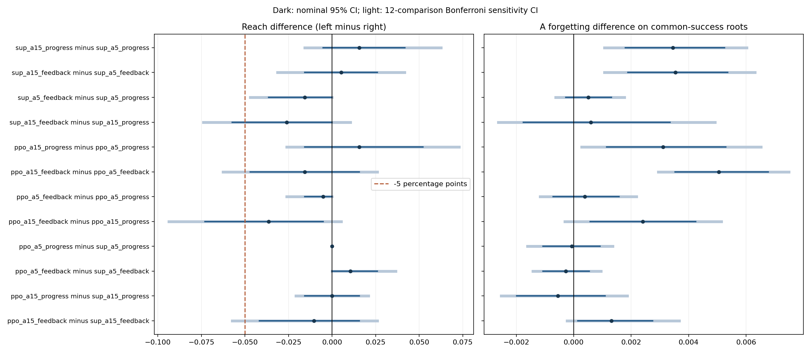

# v8：动作扩展有局部分支价值，但未转化为更好的闭环控制

**本轮没有支持“单一保护倍率是主要瓶颈”的解释。** 新动作在训练分支上提供局部改善，但四个匹配的15动作控制器在未见历史的共同成功集合上都比5动作控制器遗忘更多；12项主要比较的校正敏感性区间仍支持这一方向。没有验证旧知识反馈或PPO的稳定保留收益。开发选中的固定组合 `(0.25,1.5)` 提供了更强的保留基线。

完整正式运行约899.9秒，64 train / 24 dev / 64 test，三个初始化；完成全部监督、warm-start和PPO对照、4800条最终测试轨迹、2304条自访问PPO训练episode。原始版本与数据冻结，最终测试未用于调参。

## 动作空间确实提供了一些可用选择

固定A保护组P与其他专家U分别缩放Adam实际参数位移，矩和计数连续保留；U并不表示安全。前5档仍精确对应旧动作，新增10档是U的0.5和1.5倍率。输入18维，每5步决策，每段最多100步，共三个B；不改router、容量、A记忆或停止阈值。

534个训练状态、两个配对未来流，共16,020次干预后续跑。新增动作在227个状态上严格改善经验排序：8个提高达标率，219个在经验达标率相同时降低遗忘。148个状态全部候选均失败。按全部状态选出的最佳单次固定干预为 `(0.25,1.5)`，只匹配上述227个改善状态中的21个最优值。原始统计中“匹配250个状态”包括失败/平局，不能将其写成解释250个改善。

这些是当前干预≤5步、随后统一 `(0,1)` 续跑的经验动作价值；不是全局oracle，也不证明动态策略已能利用这些差异。

## 扩展到15动作后的正式结果

以下达标率是三个B各自在预算内曾达标的根历史内三初始化平均。每一行的遗忘比较使用该行双方全部初始化均成功的相同根历史；不同行集合不同。

| 控制器 | 5动作达标率 | 15动作达标率 | 共同根历史 | 5动作A遗忘 | 15动作A遗忘 | 遗忘差的校正区间 |
|---|---:|---:|---:|---:|---:|---|
| 监督 Progress | 83.85% | 85.42% | 53 | 0.006942 | 0.010399 | [0.001072, 0.006022] |
| 监督 Feedback | 82.29% | 82.81% | 50 | 0.006967 | 0.010506 | [0.001076, 0.006308] |
| PPO Progress | 83.85% | 85.42% | 52 | 0.006922 | 0.010034 | [0.000277, 0.006518] |
| PPO Feedback | 83.33% | 81.77% | 50 | 0.007479 | 0.012528 | [0.002945, 0.007491] |

相应遗忘增加约49.8%、50.8%、45.0%、67.5%。遗忘单位为独立A评估MSE正增量；这些百分数是相对变化，不是模型“忘掉多少知识”的比例。区间为预定12项主要比较的Bonferroni敏感性区间，按根历史bootstrap，训练seed不当作独立测试样本。

动作集扩大只保证可选集合包含旧动作，并不保证有限数据、初始化和开发选择得到的策略更好。本轮出现了明显的分支价值与闭环泛化脱节；不能据此断言更大动作空间从原理上无用。

## 动态策略、旧知识反馈与RL的贡献

开发基线完整扫描15个固定组合、7个全局学习率尺度、180个时间/段/进度切换计划。固定组合选中 `(0.25,1.5)`；调度候选池也选中该固定组合。全局学习率选中1.25倍，位于扫描内部，实际适应学习率0.01875。有限候选不等于所有调度的全局最优。

固定组合测试达标率84.38%，全局学习率85.94%。四个15动作动态组相对固定组合的共同成功遗忘差均为正；补充名义95%区间也均在零上方，但这是探索性基线比较。PPO15 Feedback与固定组合在50个共同根历史上分别为0.012528与0.005530，达标率反而低2.60个百分点；没有验证动态控制的额外优势。Progress15的达标点估计略高于固定组合，也伴随更多遗忘，不能称为全面获胜。

旧知识反馈的四个匹配遗忘差都没有显示稳定改善。PPO15 Feedback相对Progress达标率低3.65个百分点（名义95%区间[-7.29,-0.52]个百分点），共同成功A遗忘增加0.002410；两项校正敏感性区间均跨零。15动作的两项Feedback−Progress比较均未通过预定5个百分点容忍的单侧非劣效检查。5动作比较未复现v7段内反馈改善方向，跨轮差异不能单独归因于某个机制。

PPO相对监督评分器，5动作和15动作Progress的遗忘差区间均跨零；15动作Feedback反而有名义遗忘增加信号，校正区间跨零。相对自己的warm start，四个PPO组的保留收益区间均跨零。一个局部正信号是PPO15 Progress达标率相对warm从83.33%升至85.42%，名义配对区间[0.52,4.17]个百分点，但遗忘改善区间跨零，也未超过原监督组85.42%的达标率；不能据此声称RL有稳定额外收益。末轮actor的对照同样归档。

## 初始化与约束不能忽略

12个监督评分器中6个选中epoch0：5动作Progress seed882、5动作Feedback seed881/882、15动作Progress seed881/883、15动作Feedback seed882。它们属于“开发所选评分器”家族，不能将其测试表现归功于监督训练。额外epoch0测试对照统一使用slack=.1；所选epoch0可能使用不同的开发所选slack。

12个PPO中2个选中warm0：15动作Progress seed883、15动作Feedback seed882。其余10个选中PPO8/16/24。全部PPO训练都有非零actor更新；“确实训练了”不等于“训练带来泛化收益”。

预先设定 `p_min=.90`、非劣效容忍5个百分点。24个所选模型有23个开发点估计≥.90，但正式测试所有8个主要组和两种独立基线的达标点估计均低于.90。因此本轮没有满足或认证该概率目标。PPO-Lagrangian只是近似训练，不能保证约束成立。开发集较小、候选较多且出现大量epoch0选择，泛化与模型选择问题仍需诊断。

## 曾学会与最后仍保留不同

八个主要组最终全部B仍达到monitor阈值的比例为42.19%–52.60%，独立test阈值比例为22.40%–25.52%。固定组合分别为45.31%和25.00%。这进一步限制了“持续保住历史知识”的说法：A回放和监测各最多64样本始终固定，已学B没有进入记忆或奖励。扩大动作没有修复这个目标覆盖缺口。

原始轨迹同时保存逐段达标、各B最终monitor/test loss及每个A评估参考。在线观测、奖励和停止不访问这些独立测试标签。

## 开销、复现与边界

正式分支查询共1,084,145次后续learner更新；旧5档占5,340次查询/359,690次更新，额外10档占10,680次查询/724,455次更新。原行为轨迹另有7,309次更新。控制器开发搜索4,032条rollout/206,977次更新；基线搜索4,848条/272,330次更新。PPO自访问训练2,304条episode/134,831次更新；控制器优化分别为监督5,400步、蒸馏2,400步、PPO1,152步。共享初始化预训练76,000步（包含train/dev/test初始模型）。工作量代理、额外审计重跑及预检成本另存原始JSON，不等于精确FLOPs。

90项机制检查通过；4800条正式测试及2304条PPO episode审计通过；534个训练状态确定性重建全部匹配。预检82个核心文件逐字节复现。正式图表已人工查看，原始v1–v7共790个文件保持原哈希。

```bash
python3 scripts/run_experiment.py v8 --pilot --out runs/v8-pilot-new
python3 scripts/run_experiment.py v8 --out runs/v8-reproduction
python3 scripts/test_all.py
python3 scripts/verify_artifacts.py
```

固定几何router、合成非线性回归、仅三个控制器初始化、单个小开发集、有限PPO训练预算、标量上次动作编码和固定续跑标签限制外推。保留负结果，不根据这些最终测试增加训练轮数或调整动作网格。下一步应先在新训练/开发历史诊断初始化选择、teacher与闭环目标的脱节及PPO可行性，而非把本轮写成反馈或RL成功。

完整[主要统计](results/main/analysis/summary.json)、[中文原始报告](results/main/analysis/实验报告.md)、[基线补充](results/main/analysis/baseline_supplement.json)、[训练与成本](results/main/analysis/training_diagnostics.json)、[执行审计](../../docs/v8-validation.md)。


