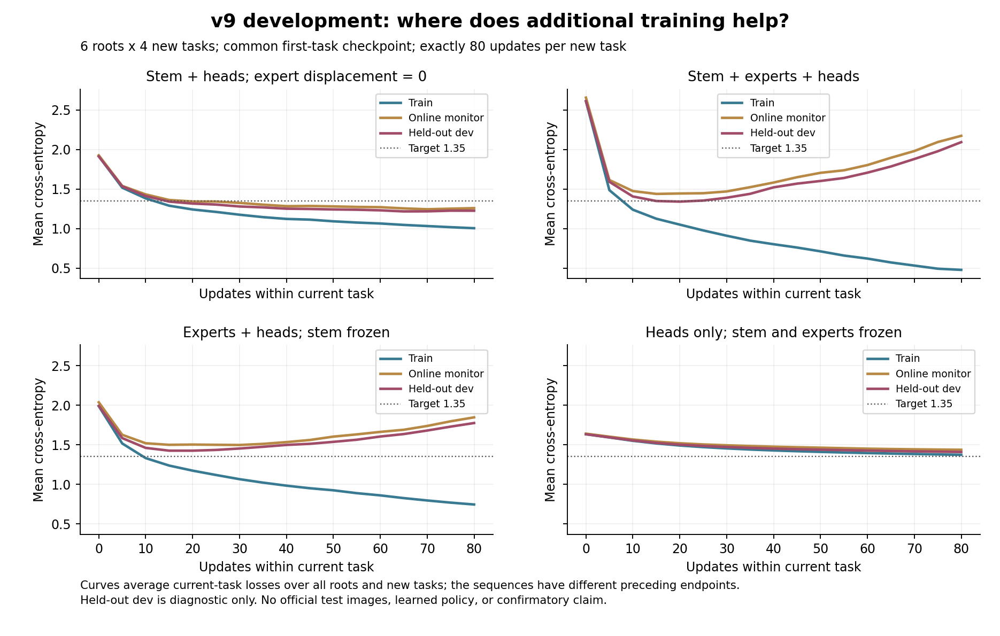

# v9：提高学习压力后，瓶颈更像泛化而非专家更新不足

2026-10-02 完成 180 条开发轨迹。更严格的新任务目标没有使全量专家更新优于零专家位移；固定预算曲线显示，全量更新能继续降低训练误差，却伴随明显的开发集误差上升。这支持先检查更新尺度与泛化，再扩大控制器训练。它不支持“专家没有用”的普遍结论，也没有验证新的学习控制器。

## 本轮实际检验了什么

使用 CIFAR-100 官方训练文件中的 v8 development 25 类池，每类 48 个训练、16 个 monitor、32 个独立开发评价样本。6 个新 roots（88410–88415）改变初始化、类别分组和样本顺序，仍共享同一类别池。没有加载官方 test 文件，也没有使用 v8 audit 结果调参。

每个 root 先用全量更新完成目标 CE=1.55 的共同首任务，随后从完整 learner、Adam、记忆和 RNG checkpoint 克隆 30 个独立分支：4 个目标 × 6 条规则的 early-stop、2 个模块冻结 early-stop，以及 4 个固定预算模块条件。共 6 × 30 = 180 条五任务轨迹。首任务分别用了 10、10、60、10、10、15 步，全部达标；后续四任务最多各 80 步。

所有条件和源码哈希在运行前锁定。训练集与独立开发集的逐窗口评价只用于诊断，不参与动作、早停或 checkpoint 选择。early-stop 每 5 步检查 monitor；fixed-budget 无论是否已达标均执行完整 80 步。两类轨迹独立运行，不能相互截断替代。

## 更严格目标没有证明全量专家更新的必要性

下表的每个分母都是 6 roots × 4 个后续任务 = 24，包含失败。`global_0` 令专家实际参数位移为零，但 stem 和任务头继续训练，专家 Adam moments 仍更新；`global_1` 则允许全部模块正常更新。“首次命中时开发集也达标”要求 monitor 首次达标时，独立开发 CE 同时低于同一阈值；从未命中计为失败。

| CE 目标 | 零专家位移：monitor 命中 | 全量更新：monitor 命中 | 零专家位移：首次命中时开发集也达标 | 全量更新：首次命中时开发集也达标 |
|---|---:|---:|---:|---:|
| 1.55 | 23/24 | 22/24 | 21/24 | 19/24 |
| 1.45 | 23/24 | 19/24 | 19/24 | 13/24 |
| 1.35 | 18/24 | 10/24 | 11/24 | 6/24 |
| 1.25 | 13/24 | 6/24 | 7/24 | 4/24 |

更严的目标增加了失败，并未产生“只有全量更新专家才能学会”的格局。monitor 达标也不等于独立开发集达标：例如目标 1.35 的零位移条件是 18/24 对 11/24。后续目标校准必须同时关注这种差距。

其他四条规则完整保留在[自动报告](results/development/analysis/实验报告.md)。目标 1.35 时，局部规则的首次命中开发达标为 13/24，高于零位移的 11/24；但 monitor 命中为 16/24，低于零位移的 18/24，平均遗忘也更高（0.392 对 0.094）。因此，零位移不是所有指标上的赢家，本轮也没有做正式优越性检验。固定路由摘要产生的这些规则不能当作已经验证了实时反馈控制。

## 固定预算揭示训练与泛化的差距

下面四个条件均在目标 1.35 下执行每个后续任务 80 步，表中 CE 是每个任务自身学习终点的均值。曾命中和末点命中使用 monitor；F 是完整历史矩阵中旧任务相对自身学习端点的平均正 CE 增量，越低表示后续退化越少。所有失败均保留。

| 可更新模块 | 训练 CE | monitor CE | 独立开发 CE | 曾命中 / 24 | 末点命中 / 24 | F |
|---|---:|---:|---:|---:|---:|---:|
| stem + 任务头，专家位移为零 | 1.005 | 1.259 | 1.226 | 18 | 15 | 0.373 |
| stem + 专家 + 任务头 | 0.478 | 2.173 | 2.093 | 9 | 0 | 1.525 |
| 专家 + 任务头，硬冻结 stem | 0.745 | 1.847 | 1.775 | 6 | 1 | 1.345 |
| 仅任务头，硬冻结 stem 和专家 | 1.374 | 1.437 | 1.410 | 4 | 4 | 0.015 |

全量更新的训练 CE 降到 0.478，而独立开发 CE 达到 2.093；学习曲线先改善、随后开发误差回升，与过拟合和更新稳定性问题相容。继续训练并不能保证保持曾经命中的目标。仅任务头的遗忘很小，但学习能力也偏弱，不能单凭低遗忘判胜。

在这一配置中，保留可训练 stem、抑制专家位移的组合表现较好。但硬冻结 stem 同时改变共享表示和专家更新的交互，且共同表示只经历了一个较弱首任务；它不能证明 stem 在所有模型中更重要，或专家本身多余。固定 80 步也只匹配更新次数，硬冻结改变实际计算，不能称为 FLOPs 匹配。

## 核查与成本

180/180 条记录符合预锁定网格；每个 root 的共同前缀指纹一致，16 个锁定 Python 源码哈希匹配。early-stop、固定预算、有限记忆和成本计数检查通过。新增 12 项机制与统计测试后，全仓库共 112 项通过；v1–v8 的 821 个归档文件保持原哈希。

物理 learner 更新为 31,735 次：共同前缀只计算一次，共 115 次；独立分支合计 31,620 次。逐行包含共享前缀的逻辑总数为 35,070，不能直接当作物理开销。训练样本处理 2,027,360 次，monitor 1,392,448 次，额外诊断训练/开发样本处理分别为 1,830,000 / 1,220,000 次，离线端点评价 432,000 次。后者沿用底层 `audit_examples` 字段名，本轮实际仍是 development 数据。

总墙钟约 302.8 秒；诊断耗时 73.3 秒已包含于 rollout 时间，不能重复相加。原始记录见[总成本](results/development/total_cost.json)和[独立审计](results/development/analysis/diagnostics.json)。

## 证据边界与下一步

这些结果只适用于当前固定原始图像路由、小型两层 MoE、每类 48 个训练样本、学习率 0.003 和最多 80 步配置。6 roots 共享 25 个开发类，不是新的独立类别总体；24 个任务也不是 24 个独立 root。没有正式测试、显著性主张或新一轮 RL 训练。各条件在首任务之后独立演化，较后任务起点会不同，不能把 early-stop 与 fixed-budget 的最终差异全部归因于同一起点上多训练几步。

下一轮值得优先做两个开发对照：一是更多训练样本与正则化，检验泛化差距是否缩小；二是更小的专家实际位移及更充分的共同表示学习，检验当前零位移优势是否依赖更新尺度和弱前缀。先在开发数据上建立合理的新任务学习与旧知识保留取舍，再锁定新协议训练控制器，最后使用未查看的测试历史确认。目标是定位真实取舍，不要求某个倍率必须胜出。
